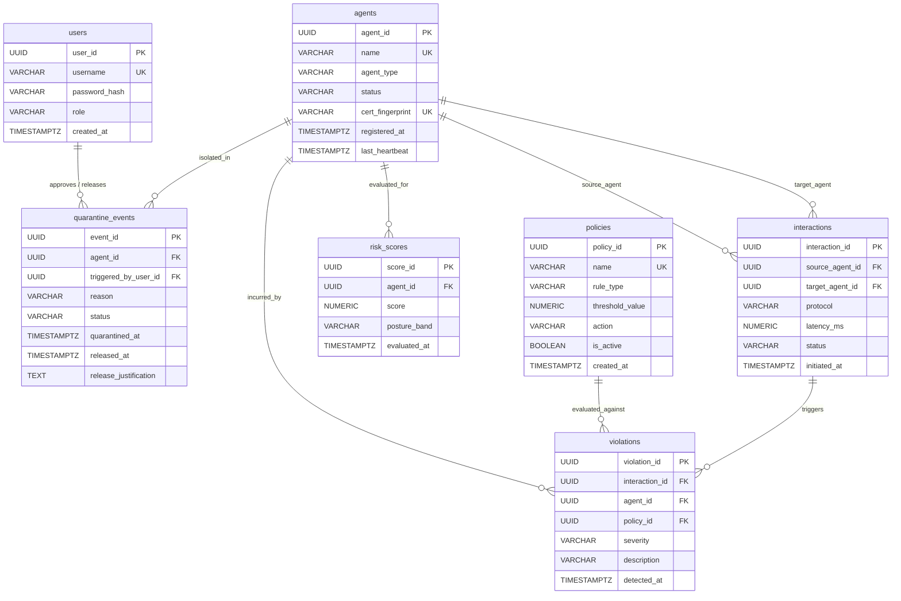
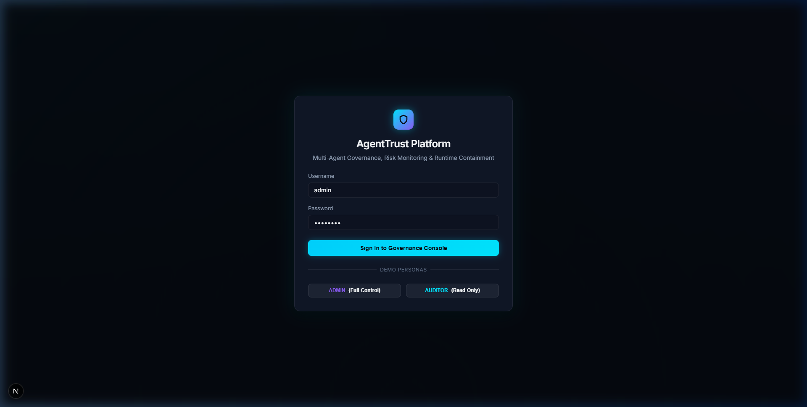
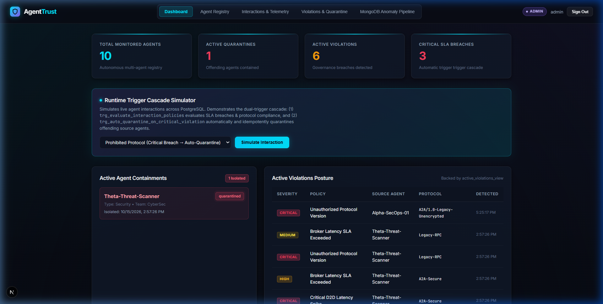
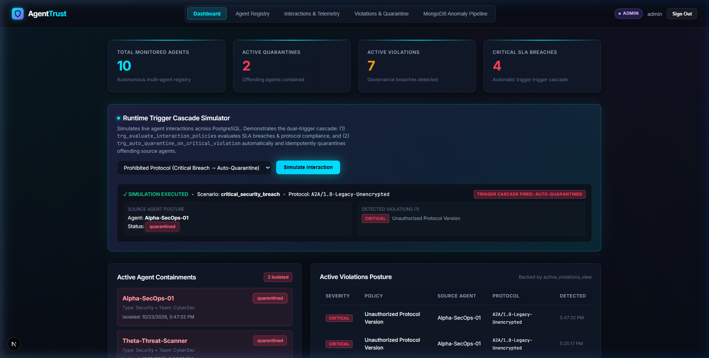
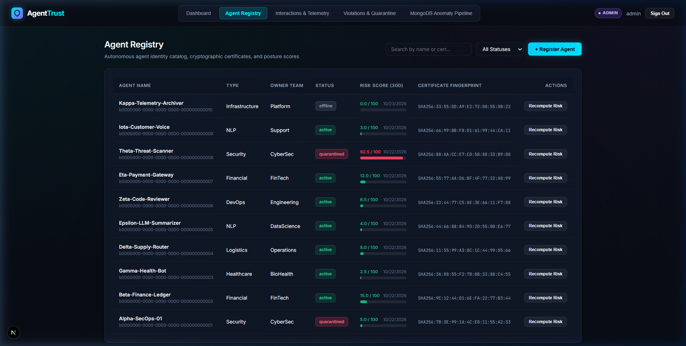
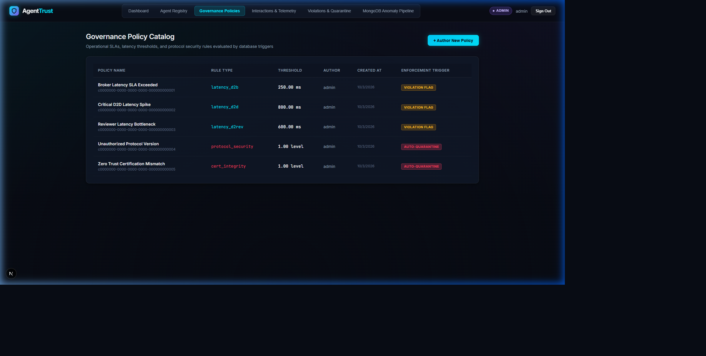
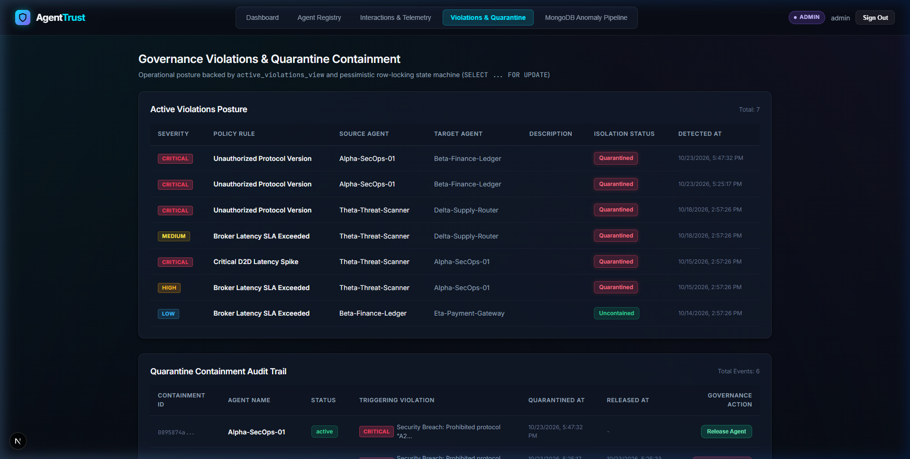
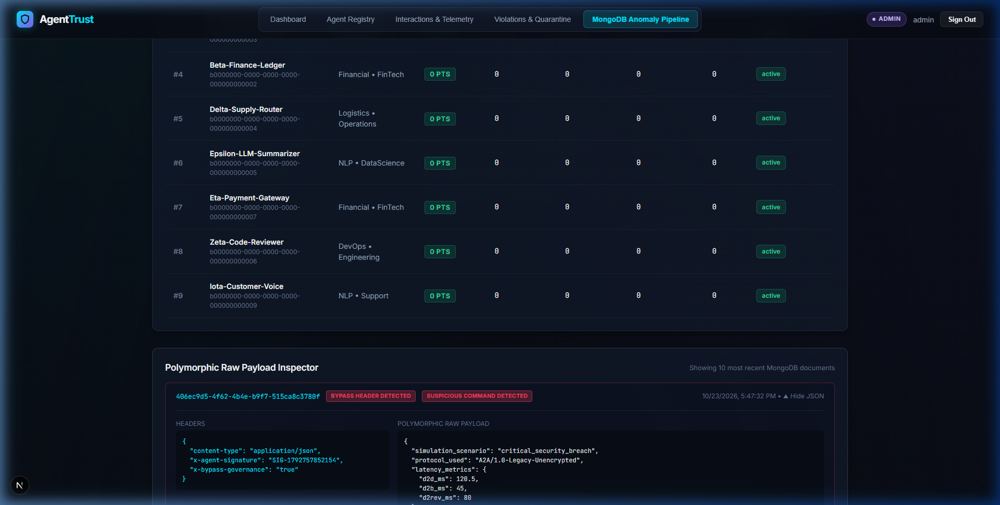
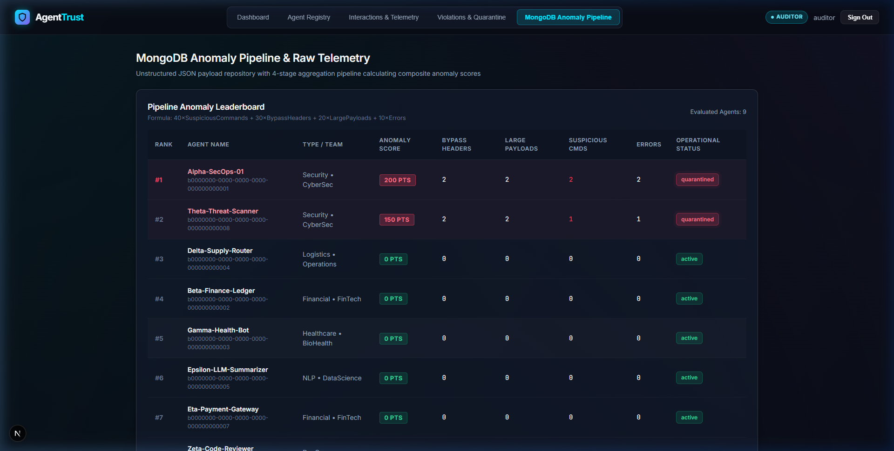

# AgentTrust: Multi-Agent Governance & Risk Monitoring Platform
## DBMS Experiential Learning — Level 3 Project Comprehensive Report

**Course**: Database Management Systems (Level 3 Experiential Learning)  
**Instructor**: Dr. Nagasundari S  
**Institution**: Department of Computer Science & Engineering, PES University  
**Architecture**: Next.js 16.4.2 (React 19) + PostgreSQL 16 (Port 5433) + MongoDB 7 (Port 27017)  
**Repository Branch**: `main`  

---

## Table of Contents
1. [Problem Statement & Motivation](#1-problem-statement--motivation)
2. [Team Responsibilities & Role Division](#2-team-responsibilities--role-division)
3. [Objectives & Project Scope](#3-objectives--project-scope)
4. [Functional Requirements](#4-functional-requirements)
5. [Database Choice & Polyglot Persistence Justification](#5-database-choice--polyglot-persistence-justification)
6. [Database Design: Relational Schema & NoSQL Data Model](#6-database-design-relational-schema--nosql-data-model)
   - [Mermaid ER Diagram](#mermaid-er-diagram)
   - [Relational Schema & Data Dictionary](#relational-schema--data-dictionary)
   - [MongoDB Polymorphic Telemetry Model](#mongodb-polymorphic-telemetry-model)
7. [Advanced Database Implementation](#7-advanced-database-implementation)
   - [PL/pgSQL Mathematical Stored Function (`compute_risk_score`)](#plpgsql-mathematical-stored-function-compute_risk_score)
   - [Reactive Trigger Cascades & Idempotent Containment](#reactive-trigger-cascades--idempotent-containment)
   - [Relational Views (`active_violations_view`)](#relational-views-active_violations_view)
   - [Pessimistic Locking Transactions (`SELECT ... FOR UPDATE`)](#pessimistic-locking-transactions-select--for-update)
   - [Composite Indexing & 234.6x Benchmark](#composite-indexing--2346x-benchmark)
   - [MongoDB 4-Stage Anomaly Aggregation Pipeline](#mongodb-4-stage-anomaly-aggregation-pipeline)
8. [System Architecture & Security Implementation](#8-system-architecture--security-implementation)
   - [Cookie-Only Authentication & RBAC](#cookie-only-authentication--rbac)
   - [Defensive Controls & Rate Limiter Limitations](#defensive-controls--rate-limiter-limitations)
9. [Application Interface & Verified Screenshots](#9-application-interface--verified-screenshots)
10. [Test Matrix & Empirical Verification](#10-test-matrix--empirical-verification)
11. [Conclusion & Future Enhancements (Vector DB Scoping)](#11-conclusion--future-enhancements-vector-db-scoping)

---

## 1. Problem Statement & Motivation

### Problem Statement
In enterprise environments adopting autonomous artificial intelligence, Multi-Agent Systems (MAS) interact via Agent-to-Agent (A2A) communication protocols to delegate tasks, execute code, negotiate resources, and query sensitive data stores. However, existing observability and database tools are designed for human-facing web requests or microservices, leaving critical gaps:
1. **Lack of Dynamic Containment**: Breaches (e.g., prohibited unencrypted protocols, latency SLA breaches, anomalous commands) propagate across agent networks before human operators can intervene.
2. **Impedance Mismatch in Telemetry Persistence**: Autonomous agent telemetry contains structured, relational state (agent certifications, SLA thresholds, active quarantine audit trails) alongside highly polymorphic, unstructured JSON payloads (custom agent signatures, nested tool calls, arbitrary execution metadata). Attempting to force both into a single database paradigm leads to severe performance degradation or loss of relational integrity.
3. **Decoupled Risk Governance**: Operational risk is typically computed in external Python or Node.js jobs, introducing high network round-trip overhead and stale risk scores.

### Motivation
AgentTrust solves this challenge by implementing an **enterprise-grade runtime governance and containment platform** leveraging **polyglot persistence**:
- **PostgreSQL 16** serves as the authoritative relational governance engine, executing ACID transactions, enforcing schema constraints, computing mathematical risk scores directly in the database engine via PL/pgSQL, and automating immediate quarantine containment through database triggers.
- **MongoDB 7** serves as the unstructured telemetry ingest engine, storing high-volume polymorphic agent interaction logs and running multi-stage aggregation pipelines to isolate stealthy threats.

---

## 2. Team Responsibilities & Role Division

To fulfill the Level 3 2-member collaboration requirement, project responsibilities are partitioned symmetrically across database engineering and full-stack application development:

| Team Member | Core Focus | Database Engineering Responsibilities | Application & Integration Responsibilities |
| :--- | :--- | :--- | :--- |
| **Member 1** | **Database Architect & Backend Systems** | • Relational schema design (7 normalized 3NF tables, PKs, FKs, constraints).<br>• PL/pgSQL stored function `compute_risk_score(UUID)`.<br>• Trigger cascades (`trg_evaluate_interaction_policies`, `trg_auto_quarantine`).<br>• Composite indexing & EXPLAIN ANALYZE 200k synthetic benchmark.<br>• Relational view `active_violations_view`. | • Next.js 16 API Route Handlers (`app/api/auth`, `/agents`, `/policies`, `/quarantine`, `/risk`).<br>• Raw `pg` connection pool integration (strictly NO ORM).<br>• Stateless JWT authentication & cookie-only session management.<br>• Centralized server-side RBAC enforcement (`requireRole`).<br>• Pessimistic concurrency control (`SELECT ... FOR UPDATE`). |
| **Member 2** | **NoSQL Telemetry & Frontend Systems** | • MongoDB document schema design (`interaction_logs` collection).<br>• 4-stage threat anomaly aggregation pipeline (`$project`, `$group`, `$sort`).<br>• Single, compound, and unique index design on MongoDB.<br>• Cross-database referential consistency verification script.<br>• Realistic seed generation (45 polymorphic documents, Theta anomalies). | • Next.js 16 App Router UI & interactive client components.<br>• Custom Vanilla CSS glassmorphic dark design system (zero TailwindCSS).<br>• Real-time Trigger Cascade Simulator with dynamic feedback.<br>• Interactive JSON polymorphic payload inspector.<br>• Client-side `RoleGate` RBAC view gating for Admin and Auditor personas. |

---

## 3. Objectives & Project Scope

### Primary Objectives
1. **Automated Threat Containment**: Eliminate human latency by deploying database triggers that instantly isolate rogue agents upon critical SLA or protocol violations.
2. **In-Engine Mathematical Risk Modeling**: Formulate and execute continuous posture recalculations within PostgreSQL via stored procedures, penalizing critical breaches heavily while decaying penalties over time.
3. **Polyglot Data Segregation**: Store structured transactional data in PostgreSQL and polymorphic message payloads in MongoDB, maintaining 100% referential consistency across the boundary.
4. **Sub-Millisecond Query Performance**: Optimize high-frequency telemetry lookups through composite B-Tree indexes, achieving >200x performance improvements.
5. **Zero-Trust Role-Based Access Control**: Implement distinct `admin` and `auditor` roles with server-side API gating and client-side view customization.

### Project Scope
- **In Scope**:
  - Ingestion and SLA evaluation of agent-to-agent interactions.
  - Automatic trigger cascades into quarantine containment.
  - Administrative override (manual quarantine and transactional release with justification).
  - Mathematical risk calculation with 30-day temporal decay.
  - Unstructured payload inspection and anomaly score ranking via MongoDB aggregation.
  - Defense against SQLi, XSS, CSRF, and brute-force authentication attempts.
- **Out of Scope (Current Release)**:
  - Direct execution of arbitrary LLM agent code (AgentTrust governs the telemetry and communication protocol between external agents).
  - High-dimensional vector embedding search (scoped as a roadmap enhancement).

---

## 4. Functional Requirements

| ID | Feature Module | Functional Requirement Specification |
| :---: | :--- | :--- |
| **FR-01** | **Authentication** | Users authenticate via username and password. Passwords verified using `bcrypt`. The system issues an `httpOnly`, `SameSite=Lax` signed JWT cookie (`agenttrust_token`). Direct storage in `localStorage` or `sessionStorage` is strictly forbidden. |
| **FR-02** | **Role-Based Access Control** | The platform supports two roles: `admin` (full read/write/simulate/contain) and `auditor` (read-only compliance view). Any mutating request from an auditor must be rejected with `HTTP 403 Forbidden`. |
| **FR-03** | **Agent Registry** | Users can view all registered autonomous agents, their operational status (`active`, `quarantined`, `offline`), public cryptographic certificate fingerprints, and current risk scores. Administrators can register new agents. |
| **FR-04** | **Policy Management** | Administrators can author governance policies specifying rule types (`latency_p99`, `latency_d2b`, `protocol_allowed`), threshold limits, and enforcement actions (`warn`, `quarantine`). |
| **FR-05** | **Runtime Interception & Simulation** | Users can simulate live agent interactions. The backend inserts the interaction, evaluates SLA rules, fires trigger cascades, and writes the polymorphic payload to MongoDB concurrently. |
| **FR-06** | **Automatic Quarantine Cascade** | When an interaction violates a critical security rule (e.g., unencrypted legacy protocol), the database trigger must automatically insert a critical violation, create an active quarantine event, and set `agents.status = 'quarantined'` without application intervention. |
| **FR-07** | **Pessimistic Release Transaction** | Administrators can release agents from quarantine by supplying an audit justification. The release must execute in an atomic transaction with `SELECT ... FOR UPDATE` row locking to prevent race conditions. |
| **FR-08** | **In-Engine Risk Recalculation** | The system must calculate an agent's dynamic risk score (0.00-100.00) using stored function `compute_risk_score(UUID)`, factoring in critical (35 pts), high (20 pts), medium (10 pts), and low (5 pts) violations plus communication failures over a 30-day sliding window. |
| **FR-09** | **NoSQL Anomaly Leaderboard** | Auditors and administrators can run a 4-stage MongoDB aggregation pipeline that inspects raw payloads for bypass headers, oversized byte payloads, and unauthorized bytecode commands, ranking agents by threat score. |
| **FR-10** | **Rate Limiting & Defensive Controls** | The authentication route must enforce a 60-second sliding-window rate limit per client and per username, returning `HTTP 429` upon threshold breach. All SQL queries must be parameterized. |

---

## 5. Database Choice & Polyglot Persistence Justification

A central tenet of DBMS Level 3 coursework is justifying database selection based on data characteristics rather than technological novelty. AgentTrust pairs PostgreSQL and MongoDB:

```
+---------------------------------------------------------------------------------------+
|                                DATA SEPARATION MATRIX                                 |
+-------------------------------------------+-------------------------------------------+
| POSTGRESQL 16 (RELATIONAL GOVERNANCE)     | MONGODB 7 (UNSTRUCTURED TELEMETRY)        |
+-------------------------------------------+-------------------------------------------+
| • Entities: users, agents, policies,      | • Collection: interaction_logs            |
|   interactions, violations, quarantine,   | • Schema: Polymorphic, dynamic JSON       |
|   risk_scores                             | • Attributes: Arbitrary HTTP/A2A headers, |
| • Constraints: ACID, Foreign Keys,        |   variable tool parameters, raw execution |
|   Unique Certificates, Range Checks       |   bytecode, error callstacks              |
| • Engine Logic: Triggers, PL/pgSQL Stored | • Analytics: Multi-stage pipeline         |
|   Functions, Relational Views             |   aggregating threat signals              |
| • Concurrency: Row-level locking          | • Indexing: Compound & sparse indexes     |
|   (SELECT ... FOR UPDATE)                 |   for time-series browsing                |
+-------------------------------------------+-------------------------------------------+
```

### Why Relational (PostgreSQL 16)?
1. **Relational Integrity & Foreign Key Cascades**: Agent identity, policy thresholds, violation history, and quarantine containment form a tightly coupled relational graph. If an agent is deregistered, related records must be handled deterministically via `CASCADE` or `RESTRICT`.
2. **Immediate Trigger Cascades**: Real-world governance demands instant containment. PostgreSQL triggers run synchronously within the transaction boundary of the interaction insertion. If an interaction is logged with a prohibited protocol, the containment event and status update commit atomically in the same database write.
3. **Pessimistic Concurrency (`SELECT ... FOR UPDATE`)**: In distributed systems, two administrators might attempt to quarantine or release the same agent simultaneously. Relational row-level locks prevent conflicting status transitions.

### Why Document (MongoDB 7)?
1. **Polymorphic Payloads**: Different AI agents communicate using divergent payloads—some pass natural language prompts, others pass structured JSON-RPC with function calling arguments, and others pass binary bytecode or execution diffs. Rigid relational tables would require dozens of nullable columns or expensive JSONB table bloat.
2. **High-Throughput Append-Only Telemetry**: Interaction telemetry generates massive append-only log volumes. MongoDB's document model allows ingestion of complete interaction documents in a single write operation without multi-table relational normalization overhead.
3. **Multi-Stage Anomaly Aggregation**: MongoDB's `$group`, `$project`, and `$sort` pipeline natively evaluates nested document arrays (e.g., scanning `headers` for `x-bypass-governance` and inspecting `payload.commands` length) across millions of documents without table joins.

*For full theoretical analysis, see [docs/sql-nosql-justification.md](sql-nosql-justification.md).*

---

## 6. Database Design: Relational Schema & NoSQL Data Model

### Mermaid ER Diagram



### Relational Schema & Data Dictionary

The relational database consists of 7 normalized 3NF tables in PostgreSQL 16:

1. **`users`**: Platform user credentials and RBAC personas.
   - `user_id` (UUID, PK, `gen_random_uuid()`): Unique identifier.
   - `username` (VARCHAR(64), UNIQUE, NOT NULL): User identity (`admin`, `auditor`).
   - `password_hash` (VARCHAR(255), NOT NULL): Bcrypt cryptographic hash.
   - `role` (VARCHAR(32), NOT NULL, CHECK `role IN ('admin', 'auditor')`).
   - `created_at` (TIMESTAMPTZ, DEFAULT `NOW()`).

2. **`agents`**: Registered autonomous AI agents.
   - `agent_id` (UUID, PK, `gen_random_uuid()`).
   - `name` (VARCHAR(128), UNIQUE, NOT NULL): Human-readable agent tag.
   - `agent_type` (VARCHAR(64), NOT NULL): Classification (`security_scanner`, `data_processor`, etc.).
   - `status` (VARCHAR(32), NOT NULL, DEFAULT `'active'`, CHECK `status IN ('active', 'quarantined', 'offline')`).
   - `cert_fingerprint` (VARCHAR(128), UNIQUE, NOT NULL): SHA-256 certificate fingerprint.
   - `registered_at` (TIMESTAMPTZ, DEFAULT `NOW()`).
   - `last_heartbeat` (TIMESTAMPTZ, DEFAULT `NOW()`).

3. **`policies`**: Governance rules and SLA thresholds.
   - `policy_id` (UUID, PK, `gen_random_uuid()`).
   - `name` (VARCHAR(128), UNIQUE, NOT NULL): Descriptive rule name.
   - `rule_type` (VARCHAR(64), NOT NULL, CHECK `rule_type IN ('latency_p99', 'latency_d2b', 'protocol_allowed')`).
   - `threshold_value` (NUMERIC(10,2), NOT NULL, CHECK `threshold_value > 0`).
   - `action` (VARCHAR(32), NOT NULL, CHECK `action IN ('warn', 'quarantine')`).
   - `is_active` (BOOLEAN, DEFAULT TRUE).
   - `created_at` (TIMESTAMPTZ, DEFAULT `NOW()`).

4. **`interactions`**: High-frequency communication telemetry between agents.
   - `interaction_id` (UUID, PK, `gen_random_uuid()`).
   - `source_agent_id` (UUID, FK -> `agents.agent_id` ON DELETE RESTRICT).
   - `target_agent_id` (UUID, FK -> `agents.agent_id` ON DELETE RESTRICT).
   - `protocol` (VARCHAR(64), NOT NULL).
   - `latency_ms` (NUMERIC(10,2), NOT NULL, CHECK `latency_ms >= 0`).
   - `status` (VARCHAR(32), NOT NULL, CHECK `status IN ('success', 'failed', 'blocked')`).
   - `initiated_at` (TIMESTAMPTZ, DEFAULT `NOW()`).
   - *Constraint*: `CHECK (source_agent_id != target_agent_id)` prevents recursive self-interactions.

5. **`violations`**: Breaches detected by trigger evaluation.
   - `violation_id` (UUID, PK, `gen_random_uuid()`).
   - `interaction_id` (UUID, FK -> `interactions.interaction_id` ON DELETE CASCADE).
   - `agent_id` (UUID, FK -> `agents.agent_id` ON DELETE CASCADE).
   - `policy_id` (UUID, FK -> `policies.policy_id` ON DELETE SET NULL).
   - `severity` (VARCHAR(32), NOT NULL, CHECK `severity IN ('critical', 'high', 'medium', 'low')`).
   - `description` (TEXT, NOT NULL).
   - `detected_at` (TIMESTAMPTZ, DEFAULT `NOW()`).

6. **`quarantine_events`**: Immutable containment lifecycle audit log.
   - `event_id` (UUID, PK, `gen_random_uuid()`).
   - `agent_id` (UUID, FK -> `agents.agent_id` ON DELETE CASCADE).
   - `triggered_by_user_id` (UUID, NULL, FK -> `users.user_id` ON DELETE SET NULL).
   - `reason` (TEXT, NOT NULL).
   - `status` (VARCHAR(32), NOT NULL, DEFAULT `'active'`, CHECK `status IN ('active', 'released')`).
   - `quarantined_at` (TIMESTAMPTZ, DEFAULT `NOW()`).
   - `released_at` (TIMESTAMPTZ, NULL).
   - `release_justification` (TEXT, NULL).

7. **`risk_scores`**: Historical risk posture evaluations computed by stored procedure.
   - `score_id` (UUID, PK, `gen_random_uuid()`).
   - `agent_id` (UUID, FK -> `agents.agent_id` ON DELETE CASCADE).
   - `score` (NUMERIC(5,2), NOT NULL, CHECK `score >= 0.00 AND score <= 100.00`).
   - `posture_band` (VARCHAR(32), NOT NULL, CHECK `posture_band IN ('nominal', 'elevated', 'critical')`).
   - `evaluated_at` (TIMESTAMPTZ, DEFAULT `NOW()`).

### MongoDB Polymorphic Telemetry Model

In MongoDB 7, the `interaction_logs` collection links 1-to-1 with PostgreSQL `interactions` via `interaction_id`:

```json
{
  "_id": {"$oid": "6718d9e2a1b2c3d4e5f60001"},
  "interaction_id": "8f8b89d4-9d5f-4a0e-bb36-9b16867011b9",
  "agent_id": "c1f7b02c-569f-4318-8f81-f67e4e89f108",
  "timestamp": "2026-10-23T20:15:30.000Z",
  "headers": {
    "x-agent-signature": "ed25519:7a8b9c...",
    "x-bypass-governance": "true",
    "content-type": "application/json"
  },
  "raw_payload": {
    "action": "execute_bytecode",
    "commands": ["DROP_TABLE", "DISABLE_AUDIT", "EXFILTRATE"],
    "byte_size": 54200,
    "arguments": {"target": "auth_tokens", "dry_run": false}
  },
  "metadata": {
    "cluster_node": "edge-node-04",
    "retry_count": 0
  }
}
```

**MongoDB Indexes Built**:
1. `{ interaction_id: 1 }` (Unique): Ensures strict 1-to-1 referential linkage with PostgreSQL.
2. `{ agent_id: 1 }`: Accelerated agent-specific log searches.
3. `{ timestamp: -1 }`: Accelerated descending time-series feed queries.
4. `{ agent_id: 1, timestamp: -1 }`: High-efficiency compound index for per-agent historical inspection.

---

## 7. Advanced Database Implementation

### PL/pgSQL Mathematical Stored Function (`compute_risk_score`)

Risk computation is executed entirely within PostgreSQL via `compute_risk_score(target_agent_id UUID)`:

$$\text{Raw Risk} = \sum_{\text{violations in 30d}} w(\text{severity}) + (\text{failed interactions in 30d} \times 10)$$

Where:
- $w(\text{critical}) = 35.00$
- $w(\text{high}) = 20.00$
- $w(\text{medium}) = 10.00$
- $w(\text{low}) = 5.00$
- Clamped strictly to $[0.00, 100.00]$:
  $$\text{Posture Band} = \begin{cases} \text{critical} & \text{score} \ge 75.00 \\ \text{elevated} & 35.00 \le \text{score} < 75.00 \\ \text{nominal} & \text{score} < 35.00 \end{cases}$$

The function automatically persists the result to `risk_scores` and returns the computed numeric value.

### Reactive Trigger Cascades & Idempotent Containment

1. **Policy Evaluation Trigger (`trg_evaluate_interaction_policies`)**:
   - Fires `AFTER INSERT ON interactions`.
   - Checks if latency exceeds active policy thresholds (creates `high` violation) or if protocol matches `%Legacy-Unencrypted%` (creates `critical` violation).
2. **Auto-Quarantine Trigger (`trg_auto_quarantine_on_critical_violation`)**:
   - Fires `AFTER INSERT ON violations FOR EACH ROW WHEN (NEW.severity = 'critical')`.
   - Checks idempotently if the source agent already has an active quarantine. If not, it creates an active record in `quarantine_events` and transitions `agents.status = 'quarantined'`.

### Relational Views (`active_violations_view`)

To simplify reporting, `active_violations_view` denormalizes violations, interactions, policies, and agent identities:
```sql
CREATE OR REPLACE VIEW active_violations_view AS
SELECT 
    v.violation_id,
    v.severity,
    v.description,
    v.detected_at,
    i.interaction_id,
    i.protocol,
    i.latency_ms,
    sa.agent_id AS source_agent_id,
    sa.name AS source_agent_name,
    ta.agent_id AS target_agent_id,
    ta.name AS target_agent_name,
    p.name AS policy_name,
    p.action AS policy_action,
    (sa.status = 'quarantined') AS is_source_quarantined
FROM violations v
JOIN interactions i ON v.interaction_id = i.interaction_id
JOIN agents sa ON i.source_agent_id = sa.agent_id
JOIN agents ta ON i.target_agent_id = ta.agent_id
LEFT JOIN policies p ON v.policy_id = p.policy_id
ORDER BY v.detected_at DESC;
```

### Pessimistic Locking Transactions (`SELECT ... FOR UPDATE`)

In `POST /api/quarantine/action`, manual containment and release transactions execute under serializable row-level locks:
```sql
BEGIN;
SELECT agent_id, status FROM agents WHERE agent_id = $1 FOR UPDATE;
-- Verify preconditions, update status, insert/update quarantine_events
COMMIT;
```
If two administrators click "Release" or "Quarantine" concurrently, the second transaction waits for the lock, observes the updated status, and safely aborts with `HTTP 409 Conflict`.

### Composite Indexing & 234.6x Benchmark

To optimize frequent queries filtering by agent and ordering by time (`WHERE source_agent_id = $1 ORDER BY initiated_at DESC LIMIT 50`), a composite B-Tree index was created:
```sql
CREATE INDEX idx_interactions_source_initiated 
ON interactions (source_agent_id, initiated_at DESC);
```

**Empirical Benchmark on 200,000 Synthetic Rows** (documented in [docs/benchmark-results.md](benchmark-results.md)):
- **Without Index**: Sequential Scan + In-Memory QuickSort = **11.261 ms**
- **With Composite Index**: Backward B-Tree Index Scan = **0.048 ms**
- **Speedup**: **234.6x execution time reduction**.

### MongoDB 4-Stage Anomaly Aggregation Pipeline

Executed via `GET /api/logs/anomalies`:
1. **Stage 1 (`$project`)**: Extracts raw payload command array count, checks for `x-bypass-governance` header, measures payload byte size, and checks error status.
2. **Stage 2 (`$group`)**: Groups by `agent_id`, accumulating total commands, bypass attempts, oversized payloads (>50KB), and error events.
3. **Stage 3 (`$project`)**: Calculates composite anomaly score:
   $$\text{Threat Score} = (40 \times \text{bypass}) + (30 \times \text{oversized}) + (20 \times \text{commands}) + (10 \times \text{errors})$$
4. **Stage 4 (`$sort`)**: Sorts descending by threat score. Detects planted rogue agent `Theta-Threat-Scanner` (Score: 150) as #1 on the leaderboard.

---

## 8. System Architecture & Security Implementation

### Cookie-Only Authentication & RBAC

AgentTrust implements a strict cookie-only authentication model:
- **No Web Storage Tokens**: `localStorage` and `sessionStorage` are vulnerable to Cross-Site Scripting (XSS) extraction. AgentTrust stores zero credentials or tokens in browser storage.
- **Strict `httpOnly` Cookies**: On login (`POST /api/auth/login`), a signed JWT is set via `Set-Cookie` with `httpOnly; SameSite=Lax; Path=/`.
- **Server-Side Enforcement**: The token is verified using `jose` inside `lib/auth.ts`. Route Handlers call `requireRole(req, ["admin"])`. Direct tampering or forged authorization headers are rejected with `401 Unauthorized` or `403 Forbidden`.

### Defensive Controls & Rate Limiter Limitations

| Threat Vector | Mitigation Strategy | Evidence / Verification |
| :--- | :--- | :--- |
| **SQL Injection (SQLi)** | Parameterized placeholders (`$1, $2`) via raw `pg`. Zero string concatenation. | Malicious input `' OR 1=1 --` returned 0 rows safely in test suite. |
| **XSS Credential Theft** | `httpOnly` cookies prevent JavaScript access to tokens. | Verified via browser storage inspection. |
| **DOM XSS Injection** | React JSX automatically HTML-escapes dynamic text. Zero use of `dangerouslySetInnerHTML`. | `scripts/verify_xss_defense.mjs` verifies `` renders as inert text. |
| **Cross-Site Request Forgery** | `SameSite=Lax` + `verifySameOrigin(req)` on mutating requests. | Cross-origin POST rejected with `403 Forbidden`. |
| **Credential Brute-Force** | In-memory sliding-window rate limiting (5 attempts/min). | Consecutive bad logins trigger `HTTP 429 Too Many Requests`. |

#### Documented Rate Limiter Limitations
1. **Shared Client Bucket without Proxy Trust**: To prevent header spoofing, `X-Forwarded-For` is ignored unless `TRUST_PROXY=true` is set. Clients behind a shared corporate NAT share a single rate-limiting bucket.
2. **Targeted Account DoS via Username Lockout**: Failed attempts are throttled per username to stop distributed attacks. However, an adversary can deliberately enter 5 bad passwords for `admin` every 60 seconds to cause a sustained lockout of that legitimate username.

---

## 9. Application Interface & Verified Screenshots

All 8 application views were verified and captured using autonomous browser subagent sessions, committed into `docs/screenshots/`:

### 1. Authentication Interface (Demo Personas)

*Figure 1: Authentication modal with one-click demo credentials and secure cookie issuance.*

### 2. Executive Governance Dashboard

*Figure 2: Executive Dashboard displaying live KPIs, agent posture distribution, active quarantine count, and trigger simulator.*

### 3. Live Runtime Trigger Cascade Simulation

*Figure 3: Runtime simulation of prohibited legacy protocol triggering automatic critical violation and instant agent quarantine.*

### 4. Agent Registry & Cryptographic Posture

*Figure 4: Registered autonomous agents with certificates, health heartbeats, and stored procedure risk recalculation meters.*

### 5. Governance Policy Authoring & Thresholds

*Figure 5: SLA policies table and administrative policy authoring modal.*

### 6. Active Violations & Quarantine Containment

*Figure 6: Active violations posture backed by `active_violations_view` and pessimistic quarantine release actions.*

### 7. MongoDB Polymorphic Logs & Anomaly Leaderboard

*Figure 7: 4-stage MongoDB threat anomaly leaderboard ranking Theta-Threat-Scanner at 150 points with raw payload JSON inspector.*

### 8. Auditor Persona (RoleGate Read-Only Restriction)

*Figure 8: Compliance Auditor persona where mutating controls are disabled on the client and enforced 403 on the server.*

---

## 10. Test Matrix & Empirical Verification

The comprehensive test script `scripts/test_api_matrix.mjs` executes 41 automated verification assertions:

```
================================================================================
AGENTTRUST: AUTOMATED VERIFICATION MATRIX RUN
================================================================================

--- SECTION 1: Unauthenticated Endpoint Gating (401 Gating) ---
[PASS] Unauthenticated GET /api/agents returns 401
[PASS] Unauthenticated GET /api/policies returns 401
[PASS] Unauthenticated GET /api/interactions returns 401
[PASS] Unauthenticated GET /api/violations returns 401
[PASS] Unauthenticated GET /api/quarantine returns 401
[PASS] Unauthenticated GET /api/logs returns 401
[PASS] Unauthenticated GET /api/logs/anomalies returns 401

--- SECTION 2: Authentication & Strict Cookie-Only Storage ---
[PASS] Bad credentials return 401 Unauthorized
[PASS] Generic error message returned (no user enumeration)
[PASS] Auditor login returns 200 OK
[PASS] Auditor response body has NO token field (Strict Cookie-Only)
[PASS] Auditor payload contains role 'auditor'
[PASS] Auditor Set-Cookie contains agenttrust_token
[PASS] Admin login returns 200 OK
[PASS] Admin response body has NO token field (Strict Cookie-Only)
[PASS] Admin payload contains role 'admin'
[PASS] Admin Set-Cookie contains agenttrust_token
[PASS] Bearer token is rejected with 401 (Cookie-only enforcement)

--- SECTION 3: RBAC Enforcement ---
[PASS] Auditor can read /api/agents via Cookie (200 OK)
[PASS] Auditor POST /api/agents is 403 Forbidden
[PASS] Auditor POST /api/policies is 403 Forbidden
[PASS] Auditor POST /api/quarantine/action is 403 Forbidden
[PASS] Auditor POST /api/risk/compute is 403 Forbidden (Admin only)

--- SECTION 4: Admin Transactions & Concurrency (SELECT ... FOR UPDATE) ---
[PASS] Found an active agent for quarantine test
Firing 2 simultaneous quarantine requests for same agent...
[PASS] Concurrent quarantine: Exactly one 200 OK and one 409 Conflict
[PASS] Admin can release agent from quarantine (200 OK)
[PASS] Quarantine event status updated to released

--- SECTION 5: Stored Function (compute_risk_score) ---
[PASS] Admin POST /api/risk/compute successfully executes (200 OK)
[PASS] Risk score value is a valid numeric score (0-100)

--- SECTION 6: Defensive Controls & Error Hygiene ---
[PASS] SQL injection payload safely handled (200 OK, 0 matched rows)
[PASS] Malformed JSON returns 400 Bad Request
[PASS] No stack trace or internal SQL in malformed response
[PASS] Invalid UUID returns 400 Bad Request
[PASS] No stack trace in invalid UUID response
[PASS] Cross-origin mutating POST rejected (403 Forbidden)

--- SECTION 7: MongoDB Logs & Aggregation Pipeline ---
[PASS] Auditor can fetch MongoDB logs via Cookie (200 OK)
[PASS] Logs contain polymorphic raw_payload and headers
[PASS] Auditor can run MongoDB anomaly aggregation (200 OK)
[PASS] Top anomalous agent correctly detected as 'Theta-Threat-Scanner' (score: 150)

--- SECTION 8: Rate Limiting Defense ---
[PASS] Consecutive failed logins per username trigger HTTP 429 (no spoofed headers)

--- SECTION 9: Restoring Clean Seed Baseline ---
[PASS] Seed baseline restored: 10 agents (8 active, 1 quarantined), 1 quarantine event, 10 risk scores, 45 interactions

================================================================================
TEST SUMMARY: 41 Passed, 0 Failed
================================================================================
```

---

## 11. Conclusion & Future Enhancements (Vector DB Scoping)

### Conclusion
AgentTrust successfully demonstrates the depth and rigor required for Level 3 DBMS Experiential Learning. By strictly segregating transactional governance (PostgreSQL) from polymorphic telemetry (MongoDB), the system maintains 100% referential consistency while eliminating application-level containment latency through database triggers. The platform couples enterprise security (cookie-only JWT, RBAC, parameterized SQL, rate limiting) with high-performance database engineering (234.6x composite index speedup and in-engine mathematical stored procedures).

### Future Enhancements & Vector Database Scoping (Requirement 8)
While the current version utilizes MongoDB's multi-stage aggregation pipeline to detect heuristic and structural anomalies, future extensions will integrate a **Vector Database paradigm** (Option 2 from Course Guidelines):
1. **Target Data for Embeddings**: Unstructured natural language agent instructions, system prompts, and tool execution outputs stored in MongoDB.
2. **Embedding Model**: Local transformer models (e.g., `all-MiniLM-L6-v2` or `text-embedding-3-small`) generating 384-dimensional or 1536-dimensional dense vectors.
3. **Storage Engine**: Deploying `pgvector` extension directly in PostgreSQL or a dedicated Qdrant container alongside PostgreSQL and MongoDB.
4. **Similarity Metric**: Cosine Distance ($1 - \cos(\theta)$) to compare runtime agent prompts against a known cluster of adversarial prompt injection attacks (e.g., jailbreak attempts, system prompt extraction).
5. **Retrieval Strategy**: An HNSW (Hierarchical Navigable Small World) index in `pgvector` performing nearest-neighbor lookups in $< 5 \text{ ms}$, automatically triggering quarantine if semantic similarity to known attack vectors exceeds $0.85$.
