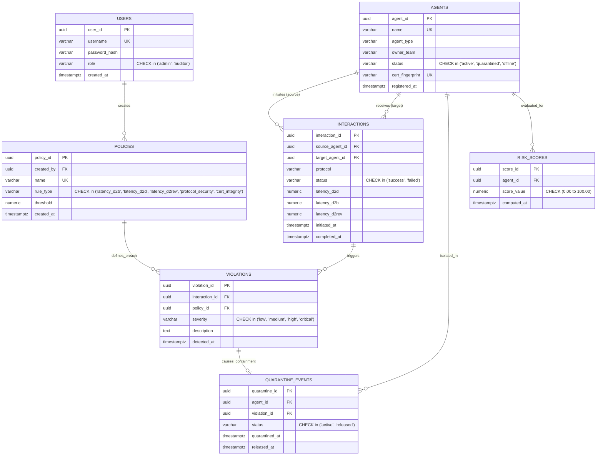

# AgentTrust: Relational Schema & Entity-Relationship Model

## 1. Entity-Relationship Diagram (Mermaid)



---

## 2. Relational Data Dictionary

### Table: `users`
| Column | Data Type | Constraints | Description |
| :--- | :--- | :--- | :--- |
| `user_id` | `UUID` | `PRIMARY KEY, DEFAULT gen_random_uuid()` | Unique identifier for operator account. |
| `username` | `VARCHAR(64)` | `UNIQUE, NOT NULL` | Unique authentication handle. |
| `password_hash` | `VARCHAR(255)` | `NOT NULL` | Bcrypt password hash (cost factor 10). |
| `role` | `VARCHAR(20)` | `NOT NULL, CHECK (role IN ('admin', 'auditor'))` | RBAC access level determining write vs read-only permissions. |
| `created_at` | `TIMESTAMPTZ` | `NOT NULL, DEFAULT NOW()` | Account creation timestamp. |

### Table: `agents`
| Column | Data Type | Constraints | Description |
| :--- | :--- | :--- | :--- |
| `agent_id` | `UUID` | `PRIMARY KEY, DEFAULT gen_random_uuid()` | Autonomous agent unique entity identifier. |
| `name` | `VARCHAR(100)` | `UNIQUE, NOT NULL` | Human-readable agent identifier (e.g., `Alpha-SecOps-01`). |
| `agent_type` | `VARCHAR(50)` | `NOT NULL` | Functional classification (`Security`, `Financial`, `Healthcare`, `Logistics`, `NLP`, `DevOps`). |
| `owner_team` | `VARCHAR(50)` | `NOT NULL` | Owning organizational unit (`CyberSec`, `FinTech`, `BioHealth`, `Operations`, `DataScience`, `Engineering`). |
| `status` | `VARCHAR(20)` | `NOT NULL, DEFAULT 'active', CHECK (status IN ('active', 'quarantined', 'offline'))` | Current operational runtime status. |
| `cert_fingerprint` | `VARCHAR(128)` | `UNIQUE, NOT NULL` | Cryptographic public key certificate fingerprint (`SHA256:...`). |
| `registered_at` | `TIMESTAMPTZ` | `NOT NULL, DEFAULT NOW()` | Identity registry registration timestamp. |

### Table: `policies`
| Column | Data Type | Constraints | Description |
| :--- | :--- | :--- | :--- |
| `policy_id` | `UUID` | `PRIMARY KEY, DEFAULT gen_random_uuid()` | Governance rule identifier. |
| `created_by` | `UUID` | `NOT NULL, REFERENCES users(user_id) ON DELETE RESTRICT` | Administrator who authored the policy. |
| `name` | `VARCHAR(120)` | `UNIQUE, NOT NULL` | Descriptive rule title (e.g., `Broker Latency SLA Exceeded`). |
| `rule_type` | `VARCHAR(50)` | `NOT NULL, CHECK (rule_type IN ('latency_d2b', 'latency_d2d', 'latency_d2rev', 'protocol_security', 'cert_integrity'))` | Classification of policy constraint. |
| `threshold` | `NUMERIC(10, 2)` | `NOT NULL, CHECK (threshold > 0.0)` | SLA threshold value in milliseconds or severity level. |
| `created_at` | `TIMESTAMPTZ` | `NOT NULL, DEFAULT NOW()` | Rule activation timestamp. |

### Table: `interactions`
| Column | Data Type | Constraints | Description |
| :--- | :--- | :--- | :--- |
| `interaction_id` | `UUID` | `PRIMARY KEY, DEFAULT gen_random_uuid()` | Unique transaction communication ID. |
| `source_agent_id` | `UUID` | `NOT NULL, REFERENCES agents(agent_id) ON DELETE CASCADE` | Sender agent initiating call. |
| `target_agent_id` | `UUID` | `NOT NULL, REFERENCES agents(agent_id) ON DELETE CASCADE` | Recipient agent processing call. |
| `protocol` | `VARCHAR(50)` | `NOT NULL` | Communication protocol (`A2A/2.0-Secure`, `A2A/1.9-gRPC`, `A2A/1.0-Legacy-Unencrypted`). |
| `status` | `VARCHAR(30)` | `NOT NULL, DEFAULT 'completed', CHECK (status IN ('completed', 'failed', 'success'))` | Interaction outcome. |
| `latency_d2d` | `NUMERIC(10, 2)` | `CHECK (latency_d2d >= 0.0)` | Device-to-device network latency (ms). |
| `latency_d2b` | `NUMERIC(10, 2)` | `CHECK (latency_d2b >= 0.0)` | Device-to-broker telemetry latency (ms). |
| `latency_d2rev` | `NUMERIC(10, 2)` | `CHECK (latency_d2rev >= 0.0)` | Device-to-reviewer review latency (ms). |
| `initiated_at` | `TIMESTAMPTZ` | `NOT NULL, DEFAULT NOW()` | Start of communication. Indexed for rolling window queries. |
| `completed_at` | `TIMESTAMPTZ` | `NULL` | Completion timestamp. |
| *Table Constraint* | `CHECK` | `source_agent_id <> target_agent_id` | Guarantees an agent cannot self-interact. |

### Table: `violations`
| Column | Data Type | Constraints | Description |
| :--- | :--- | :--- | :--- |
| `violation_id` | `UUID` | `PRIMARY KEY, DEFAULT gen_random_uuid()` | Unique governance breach event identifier. |
| `interaction_id` | `UUID` | `NOT NULL, REFERENCES interactions(interaction_id) ON DELETE CASCADE` | Associated interaction where breach was detected. |
| `policy_id` | `UUID` | `NOT NULL, REFERENCES policies(policy_id) ON DELETE RESTRICT` | Specific policy breached. |
| `severity` | `VARCHAR(20)` | `NOT NULL, CHECK (severity IN ('low', 'medium', 'high', 'critical'))` | Operational impact tier. Critical triggers auto-quarantine. |
| `description` | `TEXT` | `NOT NULL` | Detailed diagnostic audit explanation. |
| `detected_at` | `TIMESTAMPTZ` | `NOT NULL, DEFAULT NOW()` | Detection timestamp generated by trigger. |

### Table: `quarantine_events`
| Column | Data Type | Constraints | Description |
| :--- | :--- | :--- | :--- |
| `quarantine_id` | `UUID` | `PRIMARY KEY, DEFAULT gen_random_uuid()` | Containment event identifier. |
| `agent_id` | `UUID` | `NOT NULL, REFERENCES agents(agent_id) ON DELETE CASCADE` | Contained agent identifier. |
| `violation_id` | `UUID` | `NULL, REFERENCES violations(violation_id) ON DELETE SET NULL` | Triggering critical violation (null if manually quarantined). |
| `status` | `VARCHAR(20)` | `NOT NULL, DEFAULT 'active', CHECK (status IN ('active', 'released'))` | Containment status. |
| `quarantined_at` | `TIMESTAMPTZ` | `NOT NULL, DEFAULT NOW()` | Timestamp isolation went into effect. |
| `released_at` | `TIMESTAMPTZ` | `NULL` | Timestamp administrator authorized release. |
| *Partial Index* | `UNIQUE INDEX` | `idx_single_active_quarantine_per_agent ON quarantine_events(agent_id) WHERE status = 'active'` | Enforces at most ONE active quarantine per agent. |

### Table: `risk_scores`
| Column | Data Type | Constraints | Description |
| :--- | :--- | :--- | :--- |
| `score_id` | `UUID` | `PRIMARY KEY, DEFAULT gen_random_uuid()` | Posture audit score identifier. |
| `agent_id` | `UUID` | `NOT NULL, REFERENCES agents(agent_id) ON DELETE CASCADE` | Evaluated agent. |
| `score_value` | `NUMERIC(5, 2)`| `NOT NULL, CHECK (score_value >= 0.0 AND score_value <= 100.0)` | Normalized posture risk score (0.00 to 100.00). |
| `computed_at` | `TIMESTAMPTZ` | `NOT NULL, DEFAULT NOW()` | Calculation timestamp by `compute_risk_score()`. |

---

## 3. Relational View: `active_violations_view`
Defined in [db/05_views.sql](file:///c:/Users/thiji/OneDrive/Documents/Projects/DBMS/db/05_views.sql). Denormalizes active violations with source/target agent names, policy metadata, and live boolean quarantine flag:
```sql
CREATE OR REPLACE VIEW active_violations_view AS
SELECT 
    v.violation_id,
    v.interaction_id,
    i.source_agent_id,
    sa.name AS source_agent_name,
    sa.agent_type AS source_agent_type,
    sa.status AS source_agent_status,
    i.target_agent_id,
    ta.name AS target_agent_name,
    ta.agent_type AS target_agent_type,
    i.protocol,
    i.status AS interaction_status,
    i.latency_d2d,
    i.latency_d2b,
    i.latency_d2rev,
    v.policy_id,
    p.name AS policy_name,
    p.rule_type AS policy_rule_type,
    p.threshold AS policy_threshold,
    v.severity,
    v.description,
    v.detected_at,
    (sa.status = 'quarantined') AS is_source_quarantined
FROM violations v
JOIN interactions i ON v.interaction_id = i.interaction_id
JOIN agents sa ON i.source_agent_id = sa.agent_id
JOIN agents ta ON i.target_agent_id = ta.agent_id
JOIN policies p ON v.policy_id = p.policy_id;
```
